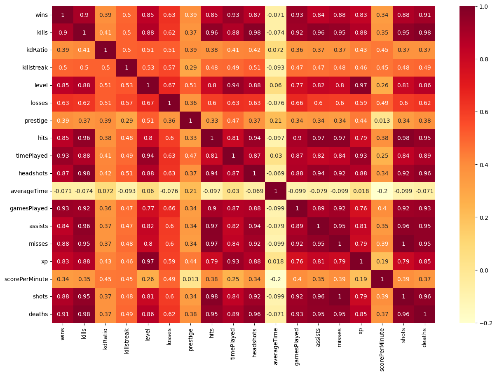
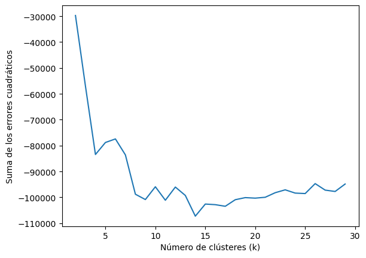
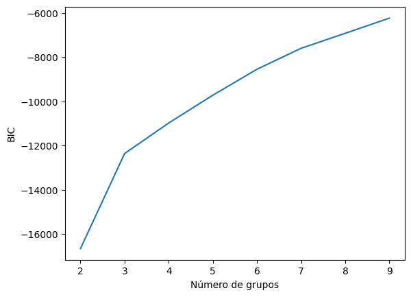

# Player Segmentation with K-Means

**Clustering Call of Duty players by their in-game statistics**

    

## Overview

Unsupervised learning to split Call of Duty players into groups with similar behaviour, from casual
players to veterans with thousands of wins.

## Dataset

Statistics of about 1,500 players: wins, kills, K/D ratio, kill streak, level, losses, prestige, hits,
time played, headshots, games played, assists, misses, XP, score per minute, shots and deaths.

## Approach

1. Preprocessing, correlation matrix and distribution analysis.
2. Outlier detection with box plots and scaling with `StandardScaler`.
3. Cluster stability with jackknife resampling.
4. Number of groups chosen with the elbow method and the BIC of Gaussian Mixture models.
5. K-Means evaluated with silhouette and Davies-Bouldin scores.
6. Profiling of every group with descriptive statistics.

## Results

| Metric (K-Means, k = 4) | Value |
| --- | --- |
| Silhouette score | 0.409 |
| Davies-Bouldin score | 1.24 |

The groups go from occasional players (about 12 wins on average) to a group of veterans with
an average of 1,157 wins.

<table>
  <tr><td align="center" valign="top"> Correlation between statistics</td><td align="center" valign="top"> Elbow method</td><td align="center" valign="top"> BIC by number of groups</td></tr>
</table>

## How to run

Open the notebook in Colab with the badge above and upload `cod.csv`.

*The notebook is written in Spanish.*

---

Made by <b>Steven Macas</b> — Data Engineer &amp; Data Analyst · <a href="https://gointy.com">gointy.com</a> · <a href="https://www.linkedin.com/in/steven-macas">LinkedIn</a> · <a href="https://github.com/Steven-Macas">GitHub</a>
